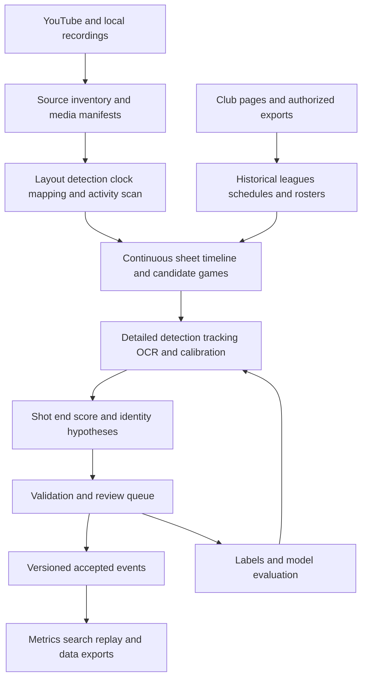

# Hogline design document

Status: proposed product and technical design. Written October 27, 2026. Initial club: Wausau Curling Club, Wisconsin. This is a specification for future implementation; no extraction system or statistical results exist yet.

Navigation: [Vision](#1-what-hogline-should-become) · [Inspected sources](#2-what-the-initial-source-inspection-establishes) · [Architecture](#5-core-architecture) · [Ingestion](#6-ingestion-and-large-scale-processing) · [All-day segmentation](#7-finding-sessions-and-games-inside-all-day-streams) · [Calibration](#8-camera-calibration-and-a-common-coordinate-system) · [Shot measurements](#9-stones-shots-timing-and-sweeping) · [Scoring](#10-automatic-end-detection-and-scoring) · [Identity](#11-teams-people-and-participation) · [Statistical interpretation](#12-ice-color-accuracy-and-statistical-interpretation) · [84-feature wishlist](#13-feature-wishlist-and-implementation-paths) · [Data model](#14-data-model-and-evidence-contracts) · [Metrics](#15-metric-definitions-and-query-behavior) · [Validation](#16-review-labeling-and-quality-assurance) · [Implementation phases](#17-staged-implementation-plan) · [Capacity](#18-capacity-and-cost-planning) · [Decisions and risks](#19-decisions-risks-and-unresolved-inputs) · [First deliverable](#20-first-useful-deliverable)

## 1. What Hogline should become

Hogline turns the club's curling recordings into a searchable, revisable dataset of games, ends, shots, stone motion, lineups, and ice behavior. Video supplies nearly all observations. Club records supply league context, schedules, team names, and roster candidates. People resolve the exceptions that the footage cannot settle.

The eventual experience should be: select a season, let Hogline process the archive, review a small queue of uncertain decisions, and ask questions such as:

- What is each team's record, including games played with substitutes?
- Which physical direction on sheet 4 runs faster, and does that change after resurfacing?
- Do red and yellow stones behave differently after accounting for teams, hammer, sheet, and stone sets?
- Where does the ice curl more, and how does a path change over a game or across a day?
- How consistent is a player's weight, line, release, and rotation on comparable shots?
- Who plays the most games, throws the most stones, or spends the most observed time curling?
- Which sheets are fastest, most predictable, most symmetric, or most forgiving?
- How often do teams steal, force one, convert hammer, recover from a bad end, or win close games?
- Can I find every shot matching a situation and watch the evidence immediately?

**The foundational unit is a continuous sheet timeline.** A YouTube recording is a media container. It may contain several games, different leagues, practice, maintenance, empty ice, or an overnight interval. A game may also span several recordings. Neither video duration nor a sheet/date title defines a game.

Preserve useful observations before deciding every interpretation. An anonymous player's shot, an uncertain score, or a partially visible trajectory can still become valuable later. Every published statistic must have a definition, eligibility rules, coverage information, and a route back to the evidence.

## 2. What the initial source inspection establishes

### 2.1 Club and league context

Wausau describes an eight-sheet facility and links its livestream archive from the club homepage. That supports a club-specific adapter covering sheets 1 through 8. It does not establish that every sheet has uninterrupted recordings. [Wausau homepage](https://wausaucurling.org/)

The public league page describes six-end and eight-end formats, flexible scheduling, liberal substitutions, and pickup leagues. MWF morning teams are formed per session and positions rotate by end; Thursday recreation also forms teams each week. Model league rules, team membership, game participation, and end roles separately. The Thursday ladies section also contains a conflicting weekday in its prose, so source conflicts need review. [League information](https://wausaucurling.org/index.php/curling/league-descriptions)

The inspected public league page is descriptive, not a full roster/schedule/standings export. No complete named team membership dataset was established from the public pages inspected. Start with those public sources, then support an authorized club export or member-area integration if required. Do not manufacture rosters from league-chair names. The March 2026 videos belong to an earlier season than the current 2026–27 website content; historical membership must be dated.

### 2.2 Recordings inspected

Metadata was retrieved with yt-dlp 2026.08.19. Selected original-resolution frames were inspected with FFmpeg; these are spot checks, not a manual annotation of every game. Durations below use individual video metadata, rounded where appropriate. Listing metadata sometimes differed by one second.

| Recording | Observed properties | Consequence for Hogline |
| --- | --- | --- |
| [SHEET 4, March 17](https://www.youtube.com/watch?v=es9urvYvLiE) | 36m 50s; 1920×1080 at nominal 30 fps; sampled at 0, 5, 15, and 30 minutes | Support partial recordings and games already in progress. |
| [SHEET 4, March 7](https://www.youtube.com/watch?v=fRnssMeHZAQ) | About 11h 5m; samples at 10m, 4h, 8h, and 10h 50m show play, empty ice, darkness, and later preparation/maintenance | Separate active curling from many hours of other footage; support calendar-date changes. |
| [SHEET 3, March 8](https://www.youtube.com/watch?v=SMjaeZF7Tn4) | About 9h 13m; samples at 10m, 5h, and 9h show empty/quiet ice and later darkness | Long duration does not imply continuous play; each sheet needs its own calibration. |
| [SHEET 5, January 16](https://www.youtube.com/watch?v=976gtQn17P0) | 10h 4m 16s; samples at 30m, 3h, 6h, and 9h show different playing groups/scoreboard states, an empty/reset interval, and evening play | Concrete multi-game, daytime-to-evening segmentation fixture; league names still require schedule evidence. |

A bounded listing of 1,200 entries from [Wausau Curling TV](https://www.youtube.com/channel/UCpQIZCWomj9fy287uBS3cxA/streams) returned 81 entries of at least four hours and 27 of at least eight hours. This is a sample of listed recordings, not a count of games or the complete archive. Three different IDs had the title `SHEET 4 | 03-17-26`; their relationship must be determined from content and time, not titles.

The owner also reports all-day streams containing different leagues. Treat this as an explicit product requirement. Sparse frame inspection does not establish the exact number or league identities of games in any long recording.

### 2.3 Observed broadcast layout

The sampled Sheet 3, Sheet 4, and Sheet 5 recordings use a composite with:

- Two large perspective views along the sheet, on the left and right.
- Two smaller overhead house views in the central column.
- A physical scoreboard visible in the left perspective view.
- A sheet label at lower left and date/time text at lower right.
- Logos, a changing advertisement between the overhead views, and occasional views of adjacent sheets or people behind glass.

In the 1920×1080 Sheet 4 sample, the central column is approximately x=720–1200. The top house occupies roughly y=0–480 and the bottom house y=600–1080. These are seed crop bounds, not finished calibration. A roughly 480-pixel-wide house view does not contain 1080p worth of house detail. Upscaling cannot recover missing stone boundaries or faces.

The scoreboard is a traditional club board: fixed numbers indicate cumulative points and movable cards indicate end numbers. A generic sports scoreboard OCR model would likely misinterpret it. [USA Curling scoreboard explanation](https://www.usacurling.org/intro-to-curling)

The footage supports a promising path to house-state reconstruction, scoreboard reading, end transitions, and delivery/arrival events. Complete stone paths, precise split times, facial matching, and handle rotation remain feasibility questions. Each depends on visibility, resolution, synchronization, and calibration at the relevant instant.

## 3. Product principles and boundaries

1. **Video first, with evidence.** Extract facts from footage and store their exact source spans. Use the website to provide context and candidate identities.
2. **Recordings, sessions, games, and ends are different entities.** Several leagues can appear in one stream; several streams can describe one game.
3. **Unknown is a valid result.** Missing, occluded, ambiguous, not applicable, not processed, and withheld are distinct from zero or false.
4. **Keep observations separate from conclusions.** OCR text is an observation; an end score is an interpretation; a win rate is a derived metric.
5. **Make corrections cheap and reversible.** A corrected game boundary or identity should update dependent statistics without re-downloading the archive.
6. **Optimize for trustworthy coverage.** Report how much of the archive and how many eligible shots support each answer. Avoid polishing a small, easy subset into a misleading league-wide claim.
7. **Use club-specific knowledge explicitly.** Camera layouts, scoreboard conventions, rules, names, and stone sets belong in versioned configuration.
8. **Build batch extraction first.** Live dashboards and coaching can come later, after offline quality and applicable league permissions are understood.
9. **Keep the dataset portable.** Open schemas, documented units, stable identifiers, SQL access, and Parquet/JSON/CSV export are product features.
10. **Do not make face recognition a prerequisite.** Anonymous game participants and verified roster links must support the core pipeline.

Initial scope is Wausau recordings and ordinary club curling. Preserve extension points for bonspiels, mixed doubles, stick curling, wheelchair curling, coaching sessions, and other clubs. Do not assume the international rulebook is the club's complete ruleset or apply today's rules retroactively to older games.

## 4. User workflows

### Import and process a season

An operator adds a channel, playlist, URL list, or local recording collection; selects a club profile and date range; sees estimated media hours and storage; then starts bounded processing. Hogline inventories sources, locates activity, separates games, and proposes identities and results. The operator can pause, resume, retry failures, or process one sheet first.

### Review a day on one sheet

A timeline shows unavailable footage, idle ice, maintenance, practice, candidate games, confirmed games, and uncertainty. Clicking a game opens its ends and shots. Boundaries can be moved, split, or merged; overlapping recordings can be compared. A schedule is shown beside the video as supporting evidence, with room for late starts and make-up games.

### Review a game

Display synchronized source views, a top-down house diagram, an end-by-end score, color assignments, game lineup, hammer, shot timeline, and confidence indicators. Clicking any value jumps to its supporting frame or clip. The reviewer can resolve a score conflict, identify a substitute, correct a missed delivery, or mark an unobservable interval.

### Explore statistics

Filter by season, league, team, game lineup, person, role, sheet, direction, stone color/set, shot type, game state, ice session, and evidence quality. Every chart can expose its underlying rows and exclusions. A saved analysis records the dataset snapshot and metric version so a later rerun can explain changes.

### Reprocess without losing human work

An improved model generates a new extraction revision. Hogline compares it with the current release, preserves human decisions, flags conflicts, and recomputes affected views. Reviewers can inspect old and new interpretations side by side.

## 5. Core architecture

Use a modular Python pipeline initially, with FFmpeg/ffprobe for media, OpenCV for calibration and image operations, a trainable detector/tracker for stones and people, a relational database for identities and events, and columnar storage for dense observations. Start on one machine with bounded workers. Add remote workers when measured throughput warrants them.



There are four durable data layers:

| Layer | Content | Update policy |
| --- | --- | --- |
| Source evidence | Video bytes, metadata snapshots, source pages/exports, media manifests | Content-addressed and immutable while retained; explicit retention/deletion policy |
| Observations | Detections, masks, OCR alternatives, frame timestamps, tracklets, quality measurements | Append by extraction run; never silently replace older outputs |
| Interpretations | Games, ends, shots, scores, identity links, repairs, rule decisions | Revisioned, with evidence and reviewer history |
| Analysis | Metrics, fitted ice models, ratings, exports, saved questions | Rebuildable from a named interpretation snapshot and metric version |

The high-level pipeline can revisit earlier decisions. A scoreboard reset may split a candidate game; later evidence may join two fragments. Persist competing hypotheses instead of forcing a one-way chain of irreversible classifications.

## 6. Ingestion and large-scale processing

### 6.1 Source inventory

Start with yt-dlp as the YouTube adapter. It supports metadata extraction, archive-based download tracking, and bounded time-range downloads through FFmpeg. Keep it replaceable because access methods and available formats change. Use the original local recordings if the club can provide them: their quality and availability may be better than a streaming copy. [yt-dlp documentation](https://github.com/yt-dlp/yt-dlp)

For each source, save platform/video ID, canonical URL, channel ID, raw and parsed title, description, retrieval time, published/released timestamps, duration, available/selected formats, resolution, codec, nominal frame rate, and availability state. Keep `title_date`, `upload_date`, `recording_clock_date`, and inferred local event date separate.

Discover incrementally, with pagination/checkpoints and a periodic reconciliation pass for edited, removed, newly public, or newly finalized recordings. Distinguish source discovery, successful download, successful processing, and inclusion in a dataset release. An item in a download archive is not proof it was analyzed.

Use bounded retries, backoff, checksums, resumable downloads, disk quotas, and an explicit unavailable-source state. Authentication, if later needed, uses an approved connection or supplied club export; credentials never belong in manifests. Acquisition and redistribution permissions are separate configuration decisions.

### 6.2 Media preservation and clocks

Preserve the highest useful original encode when feasible, plus a small review proxy. Obtain frame/packet timing and stream diagnostics with ffprobe. Do not use `frame_number / 30` as the timing source for all videos. [ffprobe documentation](https://ffmpeg.org/ffprobe.html)

Every observation carries the source media timebase and presentation timestamp (PTS). Store separate mappings for:

- Original PTS to proxy/clip PTS, including any trimming or resampling.
- Video PTS to inferred wall time, with uncertainty and discontinuity segments.
- Composite view time to physical event time, if individual camera feeds have measurable lag.
- Game-relative time to one or more source spans.

OCR the clock over many samples, then fit a robust piecewise mapping. Handle 12-hour displays without AM/PM, midnight rollover, DST, frozen overlays, encoder restarts, time jumps, and incorrect clocks. Treat America/Chicago as the club timezone, retaining UTC offsets and ambiguous-clock alternatives. A one-second overlay is useful for joining sessions, not millisecond shot timing. The March 7 long recording crosses into March 8 in its overlay; do not assign its entire contents to the date in the title.

### 6.3 Coarse scan, then detailed processing

Use a cheap first pass to find likely activity and changes: approximately one frame every 5–15 seconds plus motion summaries where decoding makes them economical. Retain uncertain intervals, including short activity bursts. Use higher sampling near transitions, scoreboard changes, and motion. Audit a random sample of intervals classified as idle so the efficiency optimization does not quietly erase games.

Process candidate play at the native useful temporal resolution, especially deliveries, line crossings, collisions, and cleanup. Stable house snapshots and scoreboard observations can use lower rates. Do not feed an eleven-hour composite to a language model as the primary measurement method.

Schedule small resumable work units, initially around 10–20 minutes with overlapping context. These are compute chunks, not games or ends. Assign each event to a single central ownership interval; use overlap only as context. Reconcile track IDs and event hypotheses across boundaries. Long games and shots crossing a chunk boundary must survive unchanged.

### 6.4 Reconcile recordings into sheet timelines

Match candidate overlaps using wall-clock hypotheses, sheet identity, perceptual frame hashes, score state, and sequences of stone/person motion. Detect exact duplicates, near duplicates, replayed footage, stream restarts, and complementary coverage. A video can contain multiple layout or camera episodes.

Create source-span relationships with explicit classes: `overlap`, `continuation`, `gap`, `duplicate`, `alternate_view`, and `unresolved`. Choose a preferred source per interval but retain other evidence. Do not count the same delivery twice because it appears in two uploads or two panels of a composite.

### 6.5 Reliability and operational requirements

Jobs need input/output hashes, stage/model/configuration versions, retry counts, leases, heartbeats, resource estimates, and a terminal failure reason. Publish results atomically after validation; at-least-once job execution must still produce one logical output per input/version. Detect corrupt outputs and expired work leases. A failed OCR stage should not erase successfully extracted trajectories.

Track wall time, CPU/GPU time, decode time, bytes downloaded, cache reuse, active footage fraction, model invocations, review minutes, and cost per accepted game/shot. Alert on stalled discovery, camera-layout drift, unexpectedly missing sheets, score-conflict spikes, identity errors, and queue growth. Use a small regression set before upgrading dependencies or models.

## 7. Finding sessions and games inside all-day streams

### 7.1 Two related timelines

Maintain a per-sheet activity timeline and a club-wide session timeline. Sheets may start or finish at different times, be idle while others are playing, or host different leagues concurrently. A club session can group likely related games without forcing identical boundaries on all sheets.

Activity states should include `unavailable`, `unknown`, `empty`, `maintenance`, `warmup`, `practice`, `organized_play`, `pause`, and `postgame`. Game states should include `candidate`, `in_progress`, `suspended`, `completed`, `conceded`, `abandoned`, and `unresolved`. Completion status and footage completeness are independent: a completed game can have missing first ends.

### 7.2 Boundary detection

Combine evidence over time rather than using a fixed two-hour splitter:

| Signal | Helps detect | Important ambiguity |
| --- | --- | --- |
| Scoreboard cleared or end cards restart | New game | Delayed cleanup, corrections, stale board, or practice |
| Participant turnover | New game/session | Substitution, people changing ends, clothing changes |
| Stones gathered and house cleared | End or game transition | Normal cleanup after every end |
| Handshakes and people leaving | Possible game completion | Greetings, nearby-sheet activity, incomplete view |
| Repeated alternating delivery cycles | Organized game | Practice can imitate parts of a game |
| Scraping, pebbling, nipping, equipment movement | New ice session | Maintenance is sometimes partial or off-camera |
| Long quiet interval or lights switching | Session boundary | Pause or camera failure |
| Schedule match | League/game candidate | Late starts, make-ups, cancellations, wrong season |
| Similar changes on neighboring sheets | Draw/session boundary | Some sheets continue playing |

A useful first implementation is an interpretable change-point detector and state machine with confidence scores. A later semi-Markov/sequence model can combine duration priors and observations. Store candidate boundary ranges, not just a falsely exact timestamp. Reviewer corrections become training labels.

### 7.3 League assignment

Join date/time, sheet, historical schedule, team candidates, and event calendar. Keep several candidate league assignments when evidence conflicts. Permit `league_id = null`; extracting a game should not depend on knowing which league it belongs to. Do not attach one league ID to an entire all-day video.

Use scheduled participants as priors, not identity truth. A substituted player, rescheduled match, pickup lineup, bonspiel, or unscheduled practice must remain representable. Two consecutive games with the same people can still be distinct games.

### 7.4 Required full-day behaviors

- Multiple games in one recording, including different leagues and immediate back-to-back starts.
- Games spanning uploads, midnight, chunk boundaries, and temporary outages.
- Empty ice and maintenance between or during sessions.
- A conceded game followed by practice with the same players.
- A scoreboard left unchanged after a game, or reset late into the next game.
- A camera staying live overnight or one panel freezing while the others continue.
- A session where some games are six ends and other activity is informal.
- No double-counting when an entire game appears in both a long stream and a separate clip.

Game boundaries, source mappings, and league assignments must each be independently editable. After a split or merge, regenerate dependent ends, lineup associations, standings, and coverage counts through the revision system.

## 8. Camera calibration and a common coordinate system

### 8.1 Separate the composite into views

Detect the layout, then crop individual camera panels and mask advertisements, borders, labels, and neighboring sheets. Calibrate each camera/view episode independently. Detect later layout changes, zooms, camera movement, exposure shifts, and frozen frames. A changing sponsor image must not trigger a new game.

Use physical sheet ends named A and B until their real club-facing names are confirmed. Do not equate left/right video panels with permanent shooting direction. Explicitly map each overhead and perspective panel to the same physical sheet coordinates using matching stone configurations and landmark geometry.

### 8.2 Geometry

Define physical coordinates in meters: origin at the A tee, positive longitudinal axis toward the B tee, lateral axis fixed to the building. Store a second shot-relative transform with forward pointing toward the receiving house and left/right defined from the deliverer's perspective. Keep both so direction comparisons never silently mirror a bias away.

Fit camera intrinsics/lens distortion where evidence permits, then a ground-plane homography from visible lines, tees, and ring geometry. Validate against landmarks withheld from the fit. Record actual calibration dimensions and tolerances; nominal regulation dimensions are a starting prior, not a site survey. A homography maps a plane, so stone handles and body centers above the ice require a height correction or an explicitly larger error bound. [OpenCV homography guide](https://docs.opencv.org/4.x/d9/dab/tutorial_homography.html)

Use stone silhouettes/edges and a stone-shape model to estimate ground-plane centers. Do not take the colored handle center as a perfect measurement of the granite footprint. Brooms and feet also have perspective and occlusion errors.

Every calibration includes camera/view ID, validity interval, crop transform, distortion parameters if available, ground transform, physical landmarks, residual errors, spatial uncertainty map, and revision. Suspend precise measurements when drift exceeds a validated limit.

### 8.3 Visibility and synchronization

Create an observability map: which cameras can see each hog line, tee line, back line, house, delivery area, and travel corridor? Mark blind sections and regions where stones are too small to measure reliably. A trajectory may be two measured fragments separated by an unknown interval.

Check inter-panel lag by matching the same motion or collision in overlapping views. Composite panels share an output clock but may contain delayed camera feeds. Estimate offsets and drift per camera episode; exclude cross-camera timings when alignment is insufficient. Never synthesize a precise hog-to-hog time when either crossing is invisible.

## 9. Stones, shots, timing, and sweeping

### 9.1 Stone detection and tracking

Begin with a small labeled dataset from Wausau: stones of both colors, clustered stones, partially hidden stones, parked stones behind the hack, moving stones, shadows, broom heads, and reflections. Compare a classical color/shape baseline with a fine-tuned object detector. Add instance masks where stone boundaries matter.

Track detections using motion prediction and data association; ByteTrack is a reasonable baseline to evaluate, particularly for maintaining tracks through weak detections. Its published generic tracking results are not a curling accuracy guarantee. SAM 2 is a candidate for accelerating annotation and repairing short difficult tracks through interactive segmentation, not a substitute for validation on small stones. [ByteTrack](https://github.com/FoundationVision/ByteTrack), [SAM 2](https://github.com/facebookresearch/sam2)

Maintain separate IDs for a detection, a per-view tracklet, a fused physical track, a delivered stone within an end, and a persistent physical stone if its number is actually readable. Following “red stone 5” within one end does not establish which granite rock it is next week.

Use physical plausibility to flag problems: impossible jumps, duplicate positions across views, color changes, unobserved stones appearing, and apparent acceleration without a collision. Constraints should identify uncertainty rather than invent a smooth path through an occlusion. After a collision, retain alternative identity assignments if the footage cannot distinguish identical stones.

### 9.2 Shot event extraction

Propose a delivery from hack-area activity, a stone beginning sustained motion, player release posture, and subsequent arrival. Associate the thrower through the delivery interaction. Use order and color alternation as soft consistency checks, with exceptions for practice, missed footage, redeliveries, rule remedies, and alternative formats.

For each shot, record when observable:

- Delivery setup, movement start, release interval, and direction.
- Team/color, thrower candidate, acting skip, sweepers, and role at that end.
- Intended shot class and target evidence, separately from observed result.
- Line crossings, trajectory samples, velocity estimates, acceleration estimates, and uncertainty.
- Handle orientation/rotation estimates, including ambiguity and missing intervals.
- Sweeping bouts, approximate locations, participants, duration, and visibility.
- Stone contacts, contact graph, removed/moved stones, rolls, and final resting states.
- Score state and house occupancy before and after the shot.
- Stop, removal, out-of-view, pickup/cleanup, and other termination reasons.

Always snapshot the house before delivery and after all affected stones settle, before people start cleanup. Preserve intermediate contact events so a double takeout, raise, or ricochet remains analyzable.

### 9.3 Timing definitions

Define every timing by endpoints and a crossing convention. Store the front edge, center, or trailing edge convention explicitly; they are different measurements. Examples include back-line-to-near-hog, tee-to-near-hog, near-hog-to-far-hog, far-hog-to-tee, release-to-stop, and final-house transit. A generic `split_time` field is insufficient.

Use original PTS and interpolate only between nearby measured observations bracketing a line. At nominal 30 fps, frames are about 33 ms apart; interpolation may refine an estimate but does not guarantee sub-frame accuracy. Propagate crossing, calibration, synchronization, and missing-frame uncertainty into the interval. Store endpoint confidence, method, convention, and whether the value is measured or predicted.

Exclude stalled, duplicated, missing, or retimed footage from high-precision timing. Detect duplicate frames within each panel, not only in the whole composite. Keep real elapsed time and dead-air/edit gaps separate. Human stopwatch labels can be a practical comparison, but manually annotated original frames are needed to evaluate the measurement itself.

### 9.4 Curl, rotation, and release

Measure lateral deviation from a defined initial line, longitudinal progress, local curvature, and final displacement. Report which fraction of the path was observed. A measured entry/exit displacement across a blind region is not a measured continuous curve.

Clockwise/counterclockwise should be defined from above in the physical coordinate system. “In-turn” and “out-turn” also require the thrower's delivery hand and should remain unknown when that is unknown. Handle tracking can estimate rotations only where sufficient orientation detail exists; symmetry and low sampling can cause aliasing. Do not infer a full rotation count from one handle angle.

Delivery line, release angle, slide path, and repeatability are candidate coaching metrics. Broom position is evidence of the called line at a moment in time, not necessarily the desired final stone position. Keep called line, target stone/region, expected path, and realized path separate.

### 9.5 Sweeping

Detect broom motion close to a moving stone and link it to a participating person. Store bout start/end, side relative to travel, approximate lead distance, visible stroke frequency, and observed duration/distance. Differentiate cleaning, active sweeping, and uncertain broom movement when the video supports it.

Ordinary video does not directly measure brush force, ice temperature, or energy applied. Swept shots are selected because players react to their weight and line; comparing swept with unswept shots naively does not identify sweeping's causal effect. Preserve the data for adjusted models or a future controlled calibration session.

## 10. Automatic end detection and scoring

### 10.1 End state machine

Model an end as `setup → delivering → settling → score_assessment → clearing → next_end`, with interruption and unresolved branches. Combine delivery count/order, active receiving house, motion settling, people gathering, measuring activity, scoreboard changes, stone clearing, and a subsequent change in direction.

Sixteen deliveries is a useful prior for a complete standard four-player end, not a mandatory trigger. Ends can be partial, conceded, replayed, interrupted, or governed by other formats. A missed delivery should not shift all later end numbers. Keep sequential observed-end index separate from official end number when earlier footage is absent.

### 10.2 Three score sources

1. **House geometry:** infer a candidate score from the last valid settled stone state.
2. **Scoreboard:** read the posted result, including updates that occur later.
3. **Confirmed result:** accept a reviewer decision or a dated club result, with source and conflict history.

These are separate claims. Agreement is useful, but observations from the same underlying source are not independent evidence. A board update is not always correct, and an overhead frame is not always the state on which players agreed.

### 10.3 Geometry scorer

Under ordinary scoring, count eligible stones in or touching the house that are nearer the tee than the opponent's nearest eligible stone. Official measurement uses the nearest part of the stone. Model the granite boundary, not just the handle or center; allow boundary and calibration uncertainty. [World Curling 2026 rules, R12](https://worldcurling.org/wp-content/uploads/2026/10/Rules-of-Curling-2026.pdf)

For a circular footprint estimate, house eligibility is approximately `distance(center, tee) <= house_radius + stone_radius`. Compare nearest-edge distances, with the appropriate boundary treatment near the tee. Sample uncertain centers/radii/calibration or use distance intervals to obtain candidate score probabilities. Closely spaced alternatives should produce `measurement_required` or `unresolved`, not a confident extra point.

Record a score only from a valid pre-cleanup state. If people move stones first, retain the prior stable frames, subsequent board evidence, and unresolved alternatives. Rule remedies or agreed stone placement can change the played result; keep those as explicit events rather than detector errors.

### 10.4 Traditional scoreboard parser

Rectify the board crop and identify fixed score columns, colored team rows, movable end cards, special markers, and card-storage areas. Template matching may work well on a fixed camera, complemented by OCR and temporal tracking. Read card value and board position separately.

Example: if red's card `2` is at cumulative total 3 and its next scoring card `5` is at total 5, red scored two in end 5. The printed `5` on the card is not five points. This example is illustrative, not a reading of the supplied game.

Require persistence across multiple frames and wait while a person is moving cards. Support overlapping cards, glare, occlusion, delayed updates, corrections, overflow/wrap conventions, and missing final scores. Learn Wausau's convention for blank ends and the card at the left of the board; do not assume it is a zero-point end. A parked next-end card, a blank-end marker, and a scoring card are different objects.

A board reset is a game-boundary candidate. It must not erase the previous game's result or reassign an old board state to the next game. Preserve each board observation and the accepted interpretation separately. See [USA Curling's traditional-board description](https://www.usacurling.org/intro-to-curling).

### 10.5 Result reconciliation

Validate end totals, team/color assignment, known hammer changes, direction changes, and league format. Do not multiply raw model confidences and call the product a calibrated probability. Calibrate the final acceptance decision on labeled games.

Use `proposed`, `auto_accepted`, `human_confirmed`, `disputed`, and `unknown` statuses. Distinguish points, blanks, unplayed ends, conceded/incomplete ends, forfeits, ties, extra ends, and missing observations. Handle the event's own rules through a versioned rule profile. A game stopping is not proof that the team currently leading won.

Preserve observed score, played result, and league standings result separately. Handicap points, forfeits, or standings points may differ from stone-derived points. A verified final result can support a win/loss record even when individual end scores remain unknown. Conversely, several known end scores do not prove the final result.

## 11. Teams, people, and participation

### 11.1 Club data adapter

Support public HTML, linked PDFs, spreadsheets/CSV, and an authorized member-area export. Start from the supplied [league page](https://wausaucurling.org/index.php/curling/league-descriptions) and [club calendar](https://wausaucurling.org/index.php/events/calendar), following relevant roster/schedule links when available. Preserve source URL or import identifier, retrieval time, source season, raw text/table location, and parser version.

Import league definitions, rules, draws, scheduled games, sheets, team names, roster members, substitutes if listed, and posted results. Extract only fields needed for this product; contact details are not required for statistical analysis. Stage uncertain name matches and conflicting records for review.

People have stable IDs and aliases. A team entry belongs to a league/season; a game lineup belongs to one game; a person's role can change by end or shot. Team continuity across seasons is a separate, editable relationship. Pickup lineups should not be collapsed into a fictitious permanent team. Skip and last thrower are separate attributes.

### 11.2 Identity resolution ladder

1. Assign anonymous actor IDs within a game and connect deliveries, sweeping, and broom-holding actions.
2. Use verified game/team matches and historical rosters to produce named candidates.
3. Let a reviewer confirm participants, substitutions, and role changes. One confirmed identity can propagate along a continuous, trustworthy track.
4. Optionally match enrolled, consenting participants with facial embeddings when image quality is sufficient.
5. Recheck uncertain joins across games, clothing changes, camera episodes, and seasons. Retain an `unknown_person` result.

Within-game clothing and motion continuity can help maintain an actor track. They do not justify naming an unfamiliar person or matching everyone wearing the same jacket across a season. Never force an unknown guest into the closest roster name. A schedule is not proof of actual attendance.

### 11.3 Optional facial matching

Treat this as a separately enabled club feature with explicit enrollment and use scope. Build the gallery from participant-provided or participant-confirmed images, including whether matching past recordings is covered. Do not build a gallery by harvesting arbitrary social media or treating a publicly posted face as enrollment.

The technical path is face detection, quality/pose filtering, alignment, embedding extraction, comparison against the permitted gallery, and temporal aggregation across suitable frames. Require a calibrated acceptance threshold, separation from alternative candidates, and compatible game context. Save the decision evidence and model/gallery revision. Test false accepts, false rejects, and unknown-person rejection on held-out footage; similarity scores alone are not probabilities.

Low-resolution faces, hats, profile views, and distant players will often require abstention. Use human confirmation for ambiguous matches and keep a non-biometric workflow fully functional. New enrollments must not silently relabel historical games outside their consent scope.

### 11.4 Data access and correction

Default named participation and player analysis to a private club/operator workspace. Provide participant correction, opt-out, enrollment withdrawal, and deletion workflows. Keep biometric templates encrypted with separate access controls and retention; do not distribute them in analysis exports. Exclude spectators, people behind glass, and adjacent-sheet bystanders from identity processing. Junior participation requires a separately approved club/guardian workflow; keep biometric matching disabled for juniors initially.

Deletion must reach templates, derived identity links, caches, thumbnails where applicable, and future processing rules. Keep nonidentifying revision tombstones where possible rather than retaining deleted personal content in an “immutable” log. Model-training inclusion is a separate permission and retention decision. The design goal is curling analysis, not tracking people's activities outside their participating games.

## 12. Ice, color, accuracy, and statistical interpretation

### 12.1 What “faster” means

Offer several explicit measurements rather than one unexplained speed score:

- Measured time between specified visible lines.
- Entry speed and remaining travel distance for comparable uncollided shots.
- Effective deceleration over a measured path segment.
- Predicted stopping distance for a standardized entry speed/rotation/sweep condition.
- Observed draw timing distributions for a defined shot class and endpoint zone.

A longer hog-to-hog time can be associated with a slower delivery on faster ice that still reaches the same target. It does not, by itself, prove slower ice. Estimate ice behavior conditionally on entry velocity, rotation, path, sweeping, collisions, and stop location. Store raw timings so future models can revisit the interpretation.

### 12.2 Ice sessions and spatial models

An ice session is the interval over which a surface condition model is plausibly shared. Seed boundaries from visible scraping/pebbling/nipping, long closures, and abrupt changes in behavior. Maintenance can be unobserved; session boundaries can remain uncertain.

Fit an initial hierarchical regression or generalized additive model with sheet, physical direction, path lane, time since maintenance, game/end stage, shot class, stone set, player, and relevant motion/sweeping covariates. Use partial pooling where a sheet/direction has few observations. A more detailed model can estimate a smooth effective speed/curl field over space and time.

Avoid claiming absolute friction, pebble geometry, or ice temperature from ordinary broadcast video. Effective deceleration may combine surface, stone, rotation, sweeping, and model error. Optional future thermometer/maintenance logs or standardized calibration shots can help separate those effects, while ordinary games remain the primary input.

An ice atlas should show speed/curl estimates, uncertainty, sample density, age of evidence, and regions with no support. Keep incoming/outgoing directions separate. Include center versus wing paths, late versus early draw, and drift over an evening. Predict landing regions as distributions, not single guaranteed points.

### 12.3 Color and individual stones

Separate handle color, team color assignment in a game, physical stone ID, stone set, and sheet allocation. A “red advantage” could reflect stronger teams choosing red, first-end hammer, specific rocks, lighting-dependent detector accuracy, or a league's assignment convention.

Start with descriptive color comparisons and adjusted associations. Include team/opponent strength, first-end hammer, direction, sheet, league, season, and time/ice session when observable. Report missing covariates and low sample sizes. Matched comparisons or a future randomized color/stone-swap calibration can strengthen interpretation. Do not label an observational association a causal color effect.

If stone numbers are legible, track individual-rock speed, curl, consistency, pair differences, maintenance changes, and possible abnormal behavior. Otherwise keep an unresolved stone-set effect; do not claim to identify individual rocks from handle color alone.

### 12.4 Player accuracy and skill

Separate **repeatability**, **target execution**, **observed outcome**, and **strategic value**:

| Concept | Example measure | Required evidence |
| --- | --- | --- |
| Repeatability | Spread of release line, crossing time, or rotation for matched shots | Comparable shot definitions and enough observations |
| Target execution | Lateral/longitudinal miss relative to the intended target | Target/line evidence captured before the outcome, or reviewer annotation |
| Outcome | Guard made, target removed, hit-and-stick, draw to a region | Before/after house states and a defined outcome rubric |
| Strategic value | Change in estimated scoring or win probability | Validated game-state model and clearly stated attribution limits |

Infer shot intention from pre-shot broom placement, target-stone pointing, context, and optional audible calls when usable. Store intent candidates, evidence, and confidence. Do not infer the target solely from where the stone finished; doing so would make every shot appear accurate. A draw to the button is not the goal of every shot.

Keep execution results stratified by shot type, turn, direction, role, difficulty, and intended weight. Sweeping and the skip's call influence outcomes; “team-assisted result” and “delivery measurement” should be distinct views. Improvement curves need enough comparable observations and uncertainty intervals.

### 12.5 Participation and sheet comparisons

“Who curls the most” can mean confirmed games, observed ends, delivered stones, league diversity, or active on-ice minutes. Provide each with its denominator. Recorded participation is a lower bound when archives or identities are incomplete; being listed on a roster does not count as playing.

“Best sheet” needs a selected criterion: highest standardized speed, lowest variation, most symmetric directions, most consistent curl, lowest anomaly rate, or best recording coverage. Publish separate dimensions before offering a user-weighted composite. Adjust for player/league mix and show rank uncertainty; avoid a definitive ranking when sample coverage differs substantially.

Use game/session-level clustered uncertainty or hierarchical models for correlated shots. Freeze analysis cohorts, test multiple-comparison sensitivity when exploring many effects, and distinguish exploratory findings from pre-specified checks. Report effect sizes and practical uncertainty, not only significance or leaderboards.

## 13. Feature wishlist and implementation paths

Priority labels describe dependencies, not promised dates: **F** is foundation/first useful release; **E** is an expansion once core extraction works; **R** is research or depends on additional evidence. All remain planned features.

### Archive and club context

| ID | Priority | Feature | Initial implementation path |
| --- | --- | --- | --- |
| A01 | F | Channel, playlist, URL, and local-file imports | Replaceable source adapters and persistent inventory |
| A02 | F | Season/sheet/date filtering and resumable backfill | Parsed metadata plus durable checkpoints |
| A03 | F | All-day activity timeline | Coarse activity model with uncertain spans retained |
| A04 | F | Multiple games and leagues per recording | Game change points and historical schedule joins |
| A05 | F | One game across multiple recordings | Content/time overlap graph and source spans |
| A06 | F | Duplicate and replay suppression | Hashes plus perceptual/event sequence matching |
| A07 | F | Layout, clock, and camera-health detection | Versioned regions and temporal quality checks |
| A08 | F | Historical leagues, teams, rosters, and rules | Source snapshots and season-aware import staging |
| A09 | F | Anonymous and pickup teams | Per-game team slots and lineups |
| A10 | E | Calendar-based missing-game audit | Scheduled games compared with accepted game inventory |
| A11 | E | Bonspiel brackets and make-up games | Separate competition/draw adapters |
| A12 | E | Incremental near-live ingestion | Finalizable media segments and provisional results |

### Game reconstruction and scoring

| ID | Priority | Feature | Initial implementation path |
| --- | --- | --- | --- |
| G01 | F | Automatic start/end of game | Multi-signal state machine with reviewable boundaries |
| G02 | F | End boundaries and physical direction | Receiving-house activity, clearing, board, and next delivery |
| G03 | F | Traditional scoreboard reading | Board rectification, card tracking, cumulative-score logic |
| G04 | F | Geometric end scoring | Stone boundaries and uncertainty-aware distance comparisons |
| G05 | F | Score conflict resolution | Parallel claims and focused review clips |
| G06 | F | Final results, concessions, ties, and unknowns | Rules profile plus completion evidence |
| G07 | F | Partial games and missing ends | Explicit coverage intervals and nullable official end numbers |
| G08 | F | Team/color mapping and first-end hammer | Verified match context plus delivery/score evidence |
| G09 | E | Hammer progression and blank ends | Rules-aware transition checks |
| G10 | E | Shot order and thrower association | Delivery tracking and per-end participation |
| G11 | E | House state after every shot | Detection, tracking, and settling classifier |
| G12 | E | Measurements, replays, placements, and corrections | Special event labels with evidence and review |
| G13 | E | Practice after concession and warm-up exclusion | Activity subtype plus game completion event |
| G14 | E | Other curling formats | Separate rules profiles and format-specific tests |

### Shot and motion measurements

| ID | Priority | Feature | Initial implementation path |
| --- | --- | --- | --- |
| S01 | E | Stone centers, footprints, and colors | Fine-tuned detector/masks plus calibrated projection |
| S02 | E | Visible trajectory fragments and speed | Tracklets, PTS, smoothing with uncertainty |
| S03 | E | Named split times | Validated line crossings and endpoint conventions |
| S04 | E | Resting positions and house occupancy | Last settled state before human movement |
| S05 | E | Collision graph, hits, raises, rolls, doubles | Contact candidates and pre/post track association |
| S06 | E | Guards, draws, takeouts, freezes, ticks, peels | Separate intent and outcome classifiers |
| S07 | E | Release/arrival line and consistency | Repeated calibrated crossings and matched-shot cohorts |
| S08 | E | Visible sweeping bouts and participants | Broom motion near stone plus actor tracking |
| S09 | E | Shot/end/game pace and pauses | Event durations with dead-air exclusions |
| S10 | R | Rotation count and release angular velocity | Handle orientation with aliasing/visibility checks |
| S11 | R | Called line and target region | Pre-shot broom/gesture evidence plus review labels |
| S12 | R | Weight/line target errors and shot grading | Intent evidence and a published grading rubric |
| S13 | R | Individual physical stone identification | Legible numbers/markings and a verified equipment registry |
| S14 | R | Delivery pose and technique consistency | Quality-gated pose tracking, calibrated camera geometry |
| S15 | R | Picks and unexpected behavior | Residual/anomaly detector; label as possible, not proven cause |
| S16 | R | Sweeping effectiveness | Matched/adjusted analysis or controlled calibration |
| S17 | R | Audible weight/line calls | Speech segmentation and review, only if game audio is usable |
| S18 | R | Full-path reconstruction through blind areas | Model predictions stored separately from observations |

### Team and player analysis

| ID | Priority | Feature | Initial implementation path |
| --- | --- | --- | --- |
| P01 | F | Team wins, losses, ties, and points | One accepted result per canonical game |
| P02 | F | Standings by season/league | League standings rules distinct from played scores |
| P03 | E | Head-to-head and schedule strength | Opponent joins with coverage and sample-size controls |
| P04 | E | Points for/against and end distributions | Accepted per-end scores, excluding unobserved ends |
| P05 | E | Steals, forces, blanks, and hammer conversion | Known hammer and exact metric denominators |
| P06 | E | Starts, finishes, comebacks, and close games | Score progression and defined game-state cohorts |
| P07 | E | Confirmed participation and substitutes | Actual game/end lineups rather than scheduled rosters |
| P08 | E | Most games, ends, stones, and active minutes | Separate counts with missing-footage bounds |
| P09 | E | Roles, turns, directions, and shot-type splits | Shot-level joins and stratified summaries |
| P10 | E | Team lineup stability and partnership records | Lineup sets and minimum-sample policies |
| P11 | R | Opt-in automatic facial matching | Enrollment gallery, calibrated matching, unknown rejection |
| P12 | R | Player consistency and improvement curves | Comparable-shot cohorts and hierarchical estimates |
| P13 | R | Player ratings across teams | Adjusted models with opponent/teammate confounding disclosed |
| P14 | R | Shot value and strategy tendencies | Validated end/win probability model with uncertainty |

### Ice, sheets, and equipment

| ID | Priority | Feature | Initial implementation path |
| --- | --- | --- | --- |
| I01 | E | Direction-specific timing distributions | Visible comparable line crossings |
| I02 | E | Speed and curl by sheet, lane, and session | Calibrated motion plus session-aware models |
| I03 | E | Ice changes through a game/day | Time-indexed residuals and change-point detection |
| I04 | E | Maintenance and reset history | Visible equipment/activity plus optional operator labels |
| I05 | E | Red/yellow outcome comparisons | Color assignments with adjusted descriptive statistics |
| I06 | R | Standardized speed/curl atlas | Conditional predictions and uncertainty/sample-density maps |
| I07 | R | Physical stone and pair behavior | Verified stone IDs and repeated comparable shots |
| I08 | R | Sheet consistency and symmetry rankings | Multi-criterion comparison with uncertainty |
| I09 | R | Freshly pebbled versus worn-path behavior | Maintenance labels and longitudinal path cohorts |
| I10 | R | Expected landing region for a specified delivery | Probabilistic trajectory model calibrated by session |
| I11 | R | Anomaly reports for ice technicians | Repeated unexplained deviations backed by clips |
| I12 | R | Optional environment correlation | Join explicitly measured temperature/humidity logs |

### Review, research, and operations

| ID | Priority | Feature | Initial implementation path |
| --- | --- | --- | --- |
| D01 | F | Evidence-linked review queue | Rank conflicts by impact, uncertainty, and review cost |
| D02 | F | Timeline split/merge and score corrections | Append revisions and invalidate dependent results |
| D03 | F | Coverage and quality dashboard | Inventory-to-analysis funnel with exclusion reasons |
| D04 | F | Reproducible exports and metric definitions | Dataset manifests, schema versions, and SQL views |
| D05 | F | Job retry, resume, budgets, and health | Durable queues, quotas, and per-stage accounting |
| D06 | E | Searchable shot library and instant replay | Structured filters and exact source-time links |
| D07 | E | Side-by-side matched-shot comparison | Shared physical coordinates and normalized timelines |
| D08 | E | Player/team season pages | Private named views with correction links |
| D09 | E | Model comparison and active learning | Frozen evaluation set plus uncertainty-selected labels |
| D10 | E | Saved queries, notebooks, and bulk data access | Read-only analytics interface and portable files |
| D11 | E | Correction impact preview and rollback | Dependency graph and release-level diffs |
| D12 | R | Natural-language questions over the dataset | Generate auditable read-only queries; show cohort and evidence |
| D13 | R | Highlight reels and coaching playlists | Reviewed shot metadata and publication permissions |
| D14 | R | Near-live score display and overlays | Provisional labels, late reconciliation, separate live policy |

## 14. Data model and evidence contracts

### 14.1 Logical schema

Use stable opaque IDs. Entity IDs should survive edits; extraction revisions and split/merge mappings describe changing interpretations. The following are logical entities, not a requirement for one physical SQL table per row.

| Entity | Essential fields and relationships |
| --- | --- |
| `club`, `sheet`, `physical_end` | Club timezone; sheet number; A/B geometry; confirmed labels |
| `source_video`, `media_asset` | Platform ID, URL, metadata snapshots, format, hashes, duration, timebase, retention/access state |
| `source_span`, `clock_mapping` | Video/view, PTS range, wall-time hypothesis, uncertainty, discontinuities, game mapping |
| `camera_episode`, `layout_profile`, `calibration` | View crops, physical camera/end, valid interval, transforms, residuals, visibility masks, synchronization |
| `activity_interval`, `club_session`, `ice_session` | Sheet time bounds, activity class, league candidates, maintenance/reset hypotheses |
| `season`, `league`, `rules_profile`, `draw` | Valid dates, competition format, scoring/tie/forfeit rules, scheduled session |
| `scheduled_game` | Expected date/time, sheet, opponent slots, schedule source/version |
| `person`, `person_alias` | Stable identity, aliases, authorized display fields, correction/privacy state |
| `team_entry`, `roster_membership` | Season/league-specific team, person, role if supplied, effective dates, source |
| `game`, `game_team` | Canonical game, sheet, session, boundaries, completion/coverage status; two team slots with optional named entry and color |
| `participation`, `role_assignment` | Person or anonymous actor, game/team, valid end/shot/time range, delivery order, acting skip/vice/sweeper, confidence |
| `end` | Game, observed index, official number if known, direction, hammer, boundaries, state, rule variant |
| `shot` | End, sequence, delivering team/actor, delivered stone, release/stop intervals, intent/outcome references |
| `stone_set`, `physical_stone`, `stone_in_end` | Equipment identity where known; per-end stone identity and color, distinct from persistent rock |
| `detection`, `tracklet`, `track_sample` | Original PTS, view/pixel coordinates, masks, calibrated position/covariance, class/color distributions, extraction run |
| `track_association` | Cross-view/chunk joins, candidate alternatives, lag mapping, evidence |
| `house_snapshot`, `stone_state` | Shot/end phase, physical positions, in-play/removed/occluded state, covariance, evidence frames |
| `line_crossing`, `timing_measurement` | Line IDs, edge convention, endpoint intervals, measured/predicted status, units, uncertainty |
| `collision`, `sweep_bout`, `target_hypothesis` | Involved stones/actors, spatial/time spans, evidence and confidence |
| `scoreboard_observation` | Board/card geometry, raw OCR alternatives, temporal persistence, source crop |
| `score_claim`, `game_result` | Candidate/accepted points or result, source kind, rule profile, confirmation state, conflict links |
| `identity_claim`, `enrollment` | Actor/person candidates, decision method, permitted scope, model/gallery revision, protected evidence |
| `review_task`, `annotation`, `correction` | Object/revision, reason, evidence, author, decision, supersedes, timestamp |
| `extraction_run`, `job`, `model_version` | Inputs, code/config/model hashes, stage state, outputs, resource usage, errors |
| `metric_definition`, `dataset_release`, `analysis_run` | Formula and filters, accepted revisions, cohort/query, model version, generated results |
| `coverage_interval`, `quality_flag` | Available/processed/observable time, capability-specific exclusions, reasons and severity |

Relationships are many-to-many where necessary: a video has many game spans, a game has many video spans, a person has many teams, and a team has many game lineups. A game team slot can exist before its club team is identified.

### 14.2 Common observation envelope

All evidence-bearing facts need an equivalent of this envelope. This synthetic example describes a candidate timing, not an extracted result from a real recording:

```json
{
  "id": "measurement_example_1",
  "schema_version": "1",
  "entity_type": "timing_measurement",
  "game_id": "game_example",
  "shot_id": "shot_example",
  "measurement": "near_hog_to_far_hog",
  "value": 13.42,
  "unit": "s",
  "interval_95": [13.34, 13.50],
  "method": "measured_line_crossings",
  "crossing_convention": "stone_center",
  "acceptance_status": "proposed",
  "evidence": [
    {
      "source_video_id": "video_example",
      "camera_episode_id": "view_example_a",
      "pts_start": 10800000,
      "pts_end": 12060000,
      "time_base_num": 1,
      "time_base_den": 90000
    }
  ],
  "calibration_ids": ["calibration_example_a"],
  "synchronization_revision": "sync_example_1",
  "extraction_run_id": "run_example",
  "missing_reason": null,
  "supersedes_id": null
}
```

Store uncertainty provenance: an interval from calibration propagation differs from an empirically validated prediction interval. A machine confidence and a human acceptance status answer different questions. Do not collapse them into one number.

### 14.3 Storage and revision strategy

Use PostgreSQL for the relational catalog, reviewed interpretations, jobs, and access control; local/object storage for media and evidence; Parquet for dense detections, trajectories, and analysis datasets; DuckDB for local analytical queries. DuckDB can query Parquet directly, making a useful initial export/analysis path. [DuckDB Parquet documentation](https://duckdb.org/docs/stable/data/parquet/overview)

Partition dense data by club/season/date/sheet and extraction version where useful; compact small files and index manifests by game/time. Avoid putting every video frame or large mask in a transactional SQL row. Store original pixel observations alongside calibrated measurements so geometry can be corrected without rerunning the detector.

An accepted dataset release references exact source manifests, extraction outputs, interpretation revisions, and metric definitions. Changes invalidate only affected descendants. A roster correction reruns person statistics, not stone detection; a clock correction re-evaluates session joins and timings; a game split regenerates game-derived metrics. Human corrections are protected inputs, with explicit conflict review when a model disagrees.

Retain raw originals when storage and permissions permit. If originals must be removed, preserve the best available evidence and mark which future measurements can no longer be reproduced. Evidence clips alone cannot support every future question. Store deletions and missing assets as explicit manifest states.

## 15. Metric definitions and query behavior

Every metric declares its grain, unit, numerator, denominator, eligibility filters, handling of ties/unknowns, minimum sample policy, and version. Proposed initial definitions include:

| Metric | Definition and exclusions |
| --- | --- |
| Team record | Counts of accepted wins/losses/ties on canonical games; separate forfeits and non-final games |
| Decided-game win rate | Wins / (wins + losses); show ties separately and never silently include them |
| Points per completed end | Accepted points / eligible fully scored ends; omit unplayed/unobserved ends |
| Steal rate | Ends scoring at least one without hammer / eligible ends played without hammer |
| Hammer conversion | Ends scoring at least two with hammer / eligible ends played with hammer; disclose whether blanks are included |
| Force-one rate | Ends where opponent scores exactly one / eligible ends where opponent has hammer |
| Blank rate | Confirmed blank ends / eligible completed ends |
| Draw target error | Signed lateral/longitudinal and radial miss against a pre-shot target; only a declared draw/target cohort |
| Weight consistency | Robust dispersion of a named timing/speed within matched shot classes and conditions |
| Takeout outcome rate | Target removal outcomes / eligible intended takeouts with known target; stratify hit-and-stick/roll/double objectives |
| Direction effect | Adjusted difference in a defined speed/curl outcome between A→B and B→A with uncertainty |
| Color association | Adjusted red/yellow difference for a defined outcome and known game color assignments |
| Participation count | Unique accepted game/person participation; a source duplicate contributes zero additional games |
| Active minutes | Union of eligible observed participant intervals, without overlapping-view double counting |
| Sweeping exposure | Observed swept distance or time / observable eligible moving-stone distance or time |
| Archive coverage | Available, processed, and accepted games/time relative to known inventory or schedule; denominator type shown |

These are Hogline definitions, not claims that every league uses these labels identically. League standings can have separate point systems. Export the definition with the value.

Provide three analysis modes: **confirmed** (reviewed facts), **accepted** (reviewed plus validated auto-acceptance), and **exploratory** (hypotheses and model estimates). A query should not silently switch modes. Show counts at each quality filter, including unknown identity, missing target, incomplete video, missing hammer, and uncertain calibration.

Example questions should translate to explicit analytical operations:

- “Which direction on sheet 4 is faster?” selects comparable uncollided motion/timing records, groups by ice session and direction, adjusts relevant covariates, and returns an effect interval plus supporting shots.
- “Does red win more?” uses one team-color/result row per game, shows raw rates, then adds available team/hammer/sheet/league adjustments. Do not double the sample size by treating both teams as independent games.
- “Who curled most last month?” joins accepted participation to observed game intervals, states whether the result counts games, ends, stones, or minutes, and reports unidentified/missing games.
- “Show my missed guards” requires a verified participant link, intended-guard evidence, and a declared miss definition; it should return “target unknown” when that evidence is absent.

The future natural-language interface should produce a visible query/cohort specification and use a read-only analytics role. It must not invent metrics or hide missing data to provide a neat answer.

## 16. Review, labeling, and quality assurance

### 16.1 Review interface

The first interface should make a small number of high-impact decisions quick. Show a short context clip, source views, a diagram/overlay, candidate answers, and the downstream effect of accepting each one. Keyboard shortcuts should support accepting, changing, rejecting, and marking unobservable. Avoid asking reviewers to watch an entire eleven-hour video to resolve one card.

Prioritize game merges/splits, final results, team identity, and calibration failures before low-impact shot details. Support batch approval only when the evidence is shared and the reviewer can see what is being propagated. Ask for a second review of close geometric scores and ambiguous named identity links. Separate reviewer disagreement from model error.

Review tasks should include a reason such as `score_sources_disagree`, `possible_new_game`, `unknown_substitute`, `camera_drift`, `missing_shot`, `clock_discontinuity`, or `boundary_near_chunk_edge`. Keep the evidence needed to make the decision rather than only a model-generated explanation.

### 16.2 Ground-truth plan

Begin with three manually inspected games plus one whole multi-game day. Annotate every candidate game interval, not just easily detected games, so missed-game recall is measurable. Include the supplied short fragment, the January 16 Sheet 5 stream, and overnight/idle samples as fixtures with different failure modes.

Expand to roughly 30–50 games across all eight sheets, both directions, several leagues/time slots, at least several full-day timelines, and multiple recording dates. Add held-out samples from a later season/layout. Initial annotation targets might be 2,000–5,000 diverse frames, hundreds of settled house states and board changes, several hundred timing endpoints, and a smaller fully tracked shot subset. These are budgeting starting points, not evidence that the resulting sample will establish every target error rate.

Labels should cover activity/game boundaries, end boundaries, scorecards, stone locations/colors, delivery events, timing endpoints, visible identities with permitted scope, targets when knowable, and missing/occluded evidence. Label original frames and preserve uncertainty. A close score that two reviewers cannot determine should be a correct abstention case.

Split train/validation/test by recording day and game, with duplicate uploads grouped together. For identity evaluation also hold out sessions/conditions and include people absent from the enrollment gallery. Never put adjacent frames or alternate uploads of the same game on both sides of an evaluation split. Freeze a regression set before active-learning selections begin.

### 16.3 Proposed release gates

These are engineering targets to validate and revise after the pilot, not achieved performance. Measure accepted-output precision and automation coverage together; a system that abstains on everything has not succeeded.

| Capability | Proposed gate | Measurement method |
| --- | --- | --- |
| Import/retry | No logical duplicate games/events after retries or reimport | Deterministic fixtures and content/revision checks |
| Game discovery | At least 98% recall of labeled games; false splits/merges reported separately | Fully annotated full-day timelines, not sampled game clips |
| Game boundaries | At least 95% within 60 seconds where a definite boundary exists | Label intervals; handle genuinely ambiguous transitions separately |
| Accepted end scores | At least 99% precision, with an initial useful auto-acceptance goal of 70% of eligible ends | Exact score comparison, per-sheet results, confidence intervals |
| Accepted final results | At least 99% precision; disputed/incomplete results excluded from standings | Independent result labels and game-completion review |
| Shot detection | At least 97% recall and precision on observable deliveries | One-to-one event matching with temporal tolerance |
| Stone localization | Initial goal: median ≤3 cm and 95th percentile ≤8 cm in usable house regions | Held-out calibrated annotations; near-tie scoring still abstains |
| Named timings | Initial goal: median absolute error ≤0.05 s and 95th percentile ≤0.15 s on visible endpoints | Original-frame endpoint annotation including camera lag |
| Named identity | Target false acceptance below 0.1% among accepted automated named links | Enough independent trials to bound error; open-set rejection and manual review until supported |
| Statistical correctness | Cohorts, units, exclusions, and recomputation match reviewed fixtures | Hand-worked examples and query regression tests |
| Operations | A stopped batch resumes; corrupted/missing assets are surfaced; costs stay within the configured budget | Failure injection and a bounded end-to-end backfill |

Use uncertainty intervals around measured performance. A few dozen correct results cannot substantiate a 99.9% claim. Publish per-sheet, per-layout, lighting, occlusion, and stream-length performance; a pooled average can hide an unusable sheet. Set stricter precision requirements for automatic naming than for anonymous motion tracking.

Measure review minutes per game and accepted games per operator hour. Suggested pilot ambition: most ordinary game reviews take a few minutes, with difficult cases clearly separated. Determine a realistic target from actual annotation work before scaling the archive.

### 16.4 Failure corpus

Maintain explicit fixtures for:

- A ten-hour video with several games, an empty interval, and different playing groups.
- A short fragment beginning in a late end; a game spanning two uploads; two overlapping uploads.
- Same sheet/date titles referring to different intervals; a replayed segment.
- A game/end/delivery crossing compute-chunk boundaries.
- Delayed or never-cleared scoreboards, stacked cards, a hidden final score, and ambiguous blank markers.
- Cleanup before a clear house image; a measured close stone; a biter; a tied-distance ambiguity.
- A missed delivery, burned/displaced stone remedy, re-delivery, early concession, forfeit, or tied game.
- Pickup teams, rotating positions, a substitute mid-game, and the same person playing two leagues in one day.
- People on neighboring sheets, people behind glass, hats, similar clothing, and unknown guests.
- Lights off, glare, camera motion, layout change, one frozen panel, camera lag, and corrupted frames.
- Midnight, AM/PM ambiguity, daylight-saving changes, overlay clock jumps, and upload/event-date mismatch.
- Missing rosters, conflicting schedule data, and a current roster incorrectly offered for a historical game.
- A new model that improves recall but reduces score precision or changes accepted results unexpectedly.

## 17. Staged implementation plan

### Phase 0 — Establish the source contract

Deliver a bounded channel inventory, source-profile configuration, representative sample corpus, historical roster/schedule import plan, and an annotation guide. Confirm physical A/B labels, camera crops, board conventions, and timing visibility. Include all-day and partial sources immediately.

Exit when one operator can locate a real game in a long stream, map all visible panels to the sheet, record an end's evidence correctly, and explain which measurements are unavailable. Resolve the largest feasibility risks before choosing a large model or paying for bulk GPU time.

### Phase 1 — Produce a useful game archive

Build resumable acquisition, coarse activity scanning, source-span reconciliation, candidate game segmentation, scoreboard extraction, manual game/team/score correction, and versioned exports. Use anonymous team slots where roster data is missing. Start with one sheet and one full day, then add contrasting sheets.

Deliver searchable games, partial-game status, accepted results, and coverage counts. The first vertical slice must support both multiple games per video and multiple videos per game. Face matching and full trajectories are not dependencies of this milestone.

Exit when reimport/retry does not double-count, the known full-day games are represented correctly after review, source timestamps are traceable, and the game inventory/result schema can survive a correction.

### Phase 2 — Reconstruct ends and reliable scores

Add calibrated house detection, end state tracking, geometric score proposals, traditional-board reconciliation, hammer/color assignments, league rules, and a focused review queue. Establish the frozen score/end evaluation corpus.

Deliver end-by-end game replay and trustworthy team records. Exit when the score/segmentation release gates are supported on held-out games with disclosed review load and coverage. Retain manual confirmation for cases the evidence cannot settle.

### Phase 3 — Measure shots and participation

Add delivery/actor tracking, line-crossing timings, house states after each shot, contact events, basic sweeping bouts, actual lineup/role records, and manual named links. Train on Wausau-specific examples and quantify visibility by camera.

Deliver a shot library, player participation counts, observed timing distributions, and basic outcome statistics. Exit when shot/timing quality is measured, track gaps are explicit, and identity corrections propagate correctly.

### Phase 4 — Scale to seasons and deepen analysis

Run incremental/backfill processing with quotas, manifests, remote workers if useful, dataset releases, model comparison, and anomaly monitoring. Add sheet/direction/color comparisons, ice-session models, player consistency, and configurable statistical reports.

Deliver a season dataset that can be queried without rewatching footage and can be reprocessed without losing prior review. Exit when a multi-week backfill meets throughput, review-cost, and quality budgets, including difficult days and all eight sheets.

### Phase 5 — Research features

Evaluate opt-in facial matching, stone-number recognition, rotation/pose analysis, target inference, expected-score models, and richer ice maps separately. Each feature needs its own feasibility study, labels, acceptance criteria, and fallback. A feature may remain “unobservable from this camera” indefinitely without compromising the rest of Hogline.

Near-live features follow offline correctness and a separate decision about whether/how they should be used during club games. Coaching output should clearly separate measurements from speculative causes or strategy recommendations.

### Suggested module boundaries

```text
hogline/
  adapters/       # YouTube, local media, club pages, roster/schedule exports
  media/          # Manifests, decoding, clocks, crops, quality, overlap detection
  calibration/    # Sheet geometry, transforms, visibility, synchronization
  perception/     # Stones, people, boards, broom motion, optional pose/audio
  reconstruction/ # Activity, games, ends, shots, scores, identities
  domain/         # Entities, rule profiles, revisions, evidence contracts
  analytics/      # Metric registry, cohorts, ice models, ratings, exports
  review/         # Evidence viewer, annotation tools, correction workflows
  orchestration/  # Jobs, leases, retries, budgets, backfill, monitoring
  evaluation/     # Gold labels, frozen fixtures, reports, drift checks
```

These boundaries can start inside one service/repository. Separate worker processes by resource need rather than deploying a microservice for every folder. Keep model selection behind interfaces so a detector upgrade does not redesign the game database.

## 18. Capacity and cost planning

### 18.1 Plan in recorded sheet-hours

Eight sheets recording twelve hours each produce **96 source-video hours per day**, even if only a fraction contains games. At 30 fps that is about **10.37 million composite frames**. Processing four crops per frame can multiply inference work; the four views are not four independent games.

Illustrative capacity scenario, not a measured Wausau schedule or bitrate:

| Assumption | Consequence |
| --- | --- |
| 8 sheets × 12 recorded hours × 150 days | 14,400 source-video hours per season |
| Average stored bitrate 3–10 Mb/s | About 1.35–4.5 GB per hour, or 19.4–64.8 TB per season in decimal units |
| Average 6 Mb/s | About 38.9 TB for one copy of that season |
| 40% of recorded time needs detailed processing | 5,760 detailed source hours, plus the coarse pass over all 14,400 hours |
| 4× real-time detailed throughput on one worker | About 1,440 worker-hours for the detailed pass alone |
| Eight processing hours available each day | About 4.8× aggregate real-time detailed throughput needed to keep up with 38.4 active hours/day, plus scan/decode overhead |

Backups, replicas, proxies, labels, masks, and reprocessing add storage. Empty footage may compress cheaply, so inventory actual bitrate and activity fractions before sizing hardware. Download/source retention and detailed inference are separate budgets: skipping idle inference does not automatically eliminate original-video storage.

### 18.2 Cost controls

Decode once where practical and share frames among detectors. Batch compatible crops, cache reusable outputs, avoid permanent per-frame image dumps, and store sparse observations or compressed trajectories. Use targeted expensive models only when a cheap model's uncertainty justifies the cost. Prioritize recent/important games while retaining a reproducible backlog order.

Benchmark CPU decoding, local acceleration, and any remote GPU on the same representative corpus. Measure end-to-end accepted-games/hour, including review and transfer; generic inference FPS is insufficient. No fixed hardware purchase or cloud provider is selected by this design.

Require budgets per batch for downloaded bytes, storage growth, worker time, external model spend, and reviewer minutes. Pause cleanly at limits and explain what remains. Provide a dry-run estimate and a small sample run before a season-scale backfill.

## 19. Decisions, risks, and unresolved inputs

### Design decisions made here

| Decision | Reason | Revisit when |
| --- | --- | --- |
| Continuous sheet timeline with many-to-many media/game links | Matches all-day streams, fragments, and duplicate uploads | A new source format needs additional relationships |
| Wausau adapter and versioned profiles | Fixed cameras and board conventions are valuable constraints | Supporting another club or a changed broadcast layout |
| Deterministic rules plus learned perception | Geometry/state constraints are auditable; perception handles variability | Evaluation shows a clear benefit from a different reconstruction model |
| Separate observations, interpretations, and metrics | Future questions and corrections must remain possible | Never collapse these merely to simplify a dashboard |
| Offline batch processing first | Enables reconciliation and evaluation before live publication | Archive extraction meets its quality and cost gates |
| Anonymous participation before optional face matching | Core extraction must work despite identity uncertainty | Enrolled matching proves useful and sufficiently accurate |
| Object/media storage, relational catalog, columnar analytics | Different access patterns need different storage representations | Measured scale justifies a distributed table/catalog system |
| Full-resolution evidence retained where feasible | Future measurements may need details discarded by proxies | Retention/rights/storage constraints require an explicit tradeoff |

### Highest-risk assumptions and cheap experiments

| Risk | Early experiment | Fallback |
| --- | --- | --- |
| Target line crossings are not visible | Annotate 30 varied shots per candidate timing/view | Publish only supported intervals and visible-segment speed |
| Panel feeds are delayed differently | Match shared motion across panels over several hours | Restrict timings to one view or widen uncertainty |
| Close scores exceed image precision | Independently annotate clustered/biter house states | Board/reviewer confirmation; abstain on geometry |
| Scoreboard cards are too small or unconventional | Label board states on several sheets and days | Manual score confirmation and geometric proposals |
| Multi-game boundaries are missed | Annotate a complete long day including idle periods | Review the day timeline before accepting its games |
| Historical rosters are unavailable | Inspect approved club exports for one past season | Anonymous teams/actors and manual game linking |
| Face images cannot support reliable matches | Quality and open-set evaluation on enrolled examples | Manual roster links and within-game anonymous tracks |
| Physical rock numbers cannot be read | Inspect targeted original-resolution samples | Color/set-level analysis only |
| Sweeping and delivery confound ice estimates | Fit a baseline on well-observed comparable shots | Descriptive timing distributions with no causal claim |
| Review effort dominates compute savings | Time real pilot reviews by issue type | Narrow auto-publication scope and improve high-impact errors first |

### Inputs to confirm during implementation

1. Official names/orientations of sheet ends, actual geometry, camera ownership, and whether original camera feeds exist.
2. Historical roster/schedule/result access and stable club IDs, including the 2025–26 season used by the example videos.
3. Wausau's scoreboard storage, blank-end, overflow, reset, and final-score conventions.
4. Per-league ends, time limits, ties, handicaps, substitutes, forfeits, and standings points by season.
5. Whether stone sets/numbers stay on one sheet and whether equipment/maintenance logs exist.
6. Who can see named analysis, enroll in facial matching, correct records, or publish clips/results.
7. Retention/storage budget, acceptable review workload, available hardware, and preferred backfill order.

These are implementation inputs, not prerequisites to keeping the current design. The initial pilot can proceed with anonymous participants, explicit rule assumptions, and manually verified games.

## 20. First useful deliverable

The first implementation should ingest the January 16 Sheet 5 long stream and the supplied March 17 Sheet 4 fragment, identify candidate game intervals, expose all source/clock uncertainty, extract reviewable scoreboard states and house snapshots, and export a corrected game/end dataset. It should also ingest a confirmed overlapping or continuation pair to prove that video boundaries and game boundaries are independent.

Acceptance for that deliverable is practical: an operator can find each labeled game, correct its boundaries and scores, trace every accepted value to a frame, rerun the job without duplicating games, and export records that distinguish complete, partial, and unknown information. That foundation supports the broader feature wishlist without needing to solve every computer-vision problem first.

## 21. Source and verification notes

Club facts and source observations above were checked on October 27, 2026. Source pages and video metadata can change. The bounded listing count is not a claim that the entire channel was enumerated. Sampled frames establish layout and examples of activity/idle states; they do not establish named identities, exact game counts, official league assignments, results, timing accuracy, or model performance.

Primary references are linked next to the relevant claims and methods. In particular, the current [World Curling rules index](https://worldcurling.org/rules/) points to a 2026 edition, which is useful for designing rule profiles but must not automatically govern the March 2026 recordings. Select the applicable historical rules and club variations per event.

All feature priorities, architecture choices, capacity scenarios, acceptance targets, model ideas, and rollout phases are proposed Hogline design choices. The central requirement is to preserve enough evidence and context that a new question—or a better model—can produce a better answer later.
